# Agent Entrepreneur

<p align="center"></p>

<p align="center"></p>

<p align="center"><sub>Editorial brand artwork. Portraits are illustrative and do not imply endorsement, partnership or affiliation.</sub></p>

**Version 1.0.0** · Apache-2.0 · [Changelog](CHANGELOG.md)

**A local-first, model-independent MCP server for entrepreneurial intelligence.**

Agent Entrepreneur helps a connected AI client structure business context, prepare market research, analyse supplied metrics, evaluate decisions, create execution plans and review outcomes. Its knowledge registry and specialist catalogue provide evidence-linked entrepreneurial reference material without impersonating real people.

> **Release status: v1.0.0 development baseline; stable release certification is pending.** Agent Entrepreneur is an MCP server, not a bundled chat client or autonomous hosted agent service. The connected MCP host supplies model reasoning and any external research tools. A package version is not, by itself, proof of a tagged stable release. See the [release and compatibility status](docs/client-setup.md) before deployment.

## Support the project

**Help keep entrepreneurial intelligence open, independent and useful to builders worldwide.**

If Agent Entrepreneur is useful to your work, consider [sponsoring its development](https://github.com/sponsors/shaideroff). Sponsorship helps fund ongoing maintenance, security and compatibility work, documentation, testing, and evidence-led expansion of the entrepreneur knowledge registry.

- **Individuals:** sponsor at a level that fits your budget.
- **Founders and builders:** help improve practical tools for business research and execution.
- **Teams and organisations:** support a model-independent, open-source MCP capability that can be used with your preferred MCP-compatible client.

Sponsorship is voluntary support for the project, not payment for a guaranteed feature, consulting service, investment return, or preferential treatment. See [SUPPORT.md](SUPPORT.md) for the funding priorities and transparency principles.

## Principles

- MCP server only; the connected AI client supplies model reasoning.
- No mandatory model-provider API key, hosted account or subscription.
- Local-first SQLite storage; memory writes require explicit consent.
- Facts, assumptions, unknowns and recommendations remain distinguishable.
- Entrepreneur profiles include attribution and evidence levels.
- No impersonation, implied endorsement or fabricated founder experience.
- No autonomous spending, customer contact, publishing or binding decisions.
- Retrieved content is untrusted input; consequential actions require human approval.

## Capabilities

Six core business tools: `understand_business`, `research_market`, `analyse_business`, `evaluate_decision`, `create_execution_plan`, and `review_outcomes`. Additional MCP tools expose the specialist workflow lifecycle (`plan_specialist_workflow`, `complete_specialist_workflow`, `resume_specialist_workflow`), searchable entrepreneur profiles (`search_entrepreneurs`), and consent-gated local memory (`save_memory`, `search_memory`, `delete_memory`). The connected MCP client performs model reasoning and submits structured specialist responses; the server validates provenance, checkpoints work and consolidates results.

The v1.1 foundation adds a 12-entry named experience-agent directory with MCP tools for discovery, profile lookup and deterministic council routing. All 12 entries are currently Preview: directory visibility is not a claim of completed dossiers or active agent execution. See the [global experience-agent directory and MCP interface](docs/global-experience-agent-directory.md). The server also exposes entrepreneur and specialist catalogue resources plus reusable business-diagnosis, market-entry and founder-execution prompts. The specialist catalogue contains 12 analytical disciplines: Founder & Bootstrapping; Technology & AI Entrepreneurship; Product & Innovation; Sales & Revenue Growth; Marketing & Brand Building; Finance & Capital Allocation; Operations & Supply Chain; Manufacturing & Industrial Business; Leadership & Organisation; Strategy & Market Expansion; Consumer & D2C Business; and Investment & Fundraising.

The initial curated entrepreneur registry contains 18 profiles across eight regions and more than 12 expertise domains. The 100-profile global registry remains a research expansion target, not a claim that 100 profiles are already verified. Profiles carry attribution, evidence levels, confidence, update dates and source metadata; unresearched methods, decisions and outcomes remain empty rather than being invented.

## Explore entrepreneurs

Discover the [public entrepreneur directory](docs/entrepreneur-discovery.md): 18 research profiles across eight regions, with research domains and links to public source material. These are reference profiles—not 18 completed AI agents. The v1.1 roadmap develops selected profiles into deeper, case-based experience dossiers; incomplete dossiers remain Preview rather than being presented as operational agents.

## Requirements and install

Python 3.11+ and an MCP-compatible AI client.

```bash
python -m venv .venv
source .venv/bin/activate  # Windows: .venv\\Scripts\\activate
python -m pip install -e '.[dev]'
agent-entrepreneur
```

STDIO is the default transport. SQLite defaults to `~/.local/share/agent-entrepreneur/data.sqlite3` (or `$XDG_DATA_HOME`). Override with `AGENT_ENTREPRENEUR_DB`.

## Configuration

| Variable | Default | Purpose |
|---|---|---|
| `AGENT_ENTREPRENEUR_DB` | platform data directory | SQLite database path |
| `AGENT_ENTREPRENEUR_TRANSPORT` | `stdio` | `stdio` or `streamable-http` |
| `AGENT_ENTREPRENEUR_HOST` | `127.0.0.1` | HTTP bind host |
| `AGENT_ENTREPRENEUR_PORT` | `8765` | HTTP port |
| `AGENT_ENTREPRENEUR_ALLOW_REMOTE_HTTP` | ignored for remote access | Legacy setting; non-loopback HTTP remains disabled until authentication is implemented |

HTTP mode is loopback-only. Non-loopback binding is deliberately disabled, including when the legacy remote opt-in variable is set. Remote deployment requires a tested OAuth 2.1 resource-server integration, TLS, rate limiting and audit controls.

## Development checks

```bash
pytest -q
ruff check .
ruff format --check .
mypy src
```

## Evidence and attribution

Evidence is assessed at the level of individual claims, not applied as a blanket judgement to an entire entrepreneur profile. Research dossiers distinguish documented facts, interpretations, assumptions, disputed claims and unknowns. Every material claim used in an active experience dossier must have traceable source provenance, limitations and relevant counter-evidence. Founder-supplied material is attributed to its source and is not represented as independent corroboration. Public directory entries introduce research subjects; they do not imply endorsement, affiliation or that a completed AI agent exists.

## Limitations

The core server does not itself browse the live web, call an LLM, execute code, contact customers or perform transactions. `research_market` reports when no research provider is configured rather than inventing current findings. The specialist orchestration module prepares bounded specialist tasks; the connected client performs the reasoning.

See [MCP client setup and client compatibility status](docs/client-setup.md), [specialist workflow protocol](docs/specialist-workflows.md), [SQLite backup and restore](docs/backup-and-restore.md), [SECURITY.md](SECURITY.md), [docs/security-model.md](docs/security-model.md) and [docs/knowledge-and-evidence.md](docs/knowledge-and-evidence.md).

## Licence

Apache-2.0. See [LICENSE](LICENSE).
