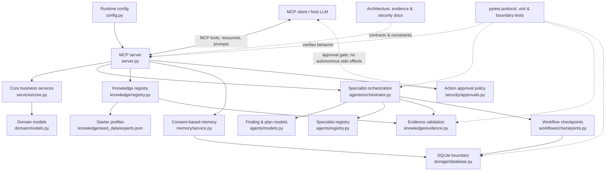
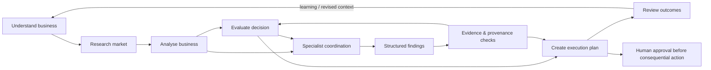

# Agent Entrepreneur — Architecture Graph

> Graphify snapshot of the repository at the time of this commit. This is a documentation-level architecture graph, not a runtime dependency scanner or a claim that every edge is statically verified. Paths and relationships are mapped from the current repository structure and documented contracts.

## System graph

## Founder workflow graph

## Component inventory

| Area | Primary path | Responsibility |
|---|---|---|
| MCP interface | `src/agent_entrepreneur/server.py` | Exposes the six tools, two resources and three prompts over the MCP server |
| Configuration | `src/agent_entrepreneur/config.py` | Validates transport, host and port; remote HTTP remains fail-closed |
| Domain | `src/agent_entrepreneur/domain/models.py` | Shared business-domain data structures |
| Core services | `src/agent_entrepreneur/services/core.py` | Deterministic business analysis and workflow service logic |
| Specialist engine | `src/agent_entrepreneur/agents/` | Specialist selection, bounded execution, structured findings and resume |
| Knowledge | `src/agent_entrepreneur/knowledge/registry.py` | Searchable founder/specialist reference registry |
| Evidence | `src/agent_entrepreneur/knowledge/evidence.py` | Claim/source validation and freshness checks |
| Local memory | `src/agent_entrepreneur/memory/service.py` | Explicit-consent memory writes |
| Persistence | `src/agent_entrepreneur/storage/database.py` | SQLite connection and local filesystem protections |
| Checkpoints | `src/agent_entrepreneur/workflows/checkpoints.py` | Durable workflow state and resume validation |
| Action policy | `src/agent_entrepreneur/security/approvals.py` | Human-approval boundary for consequential actions |
| Tests | `tests/` | MCP protocol, config, core, evidence, orchestration, memory, server and storage coverage |

## MCP surface

| Kind | Contract |
|---|---|
| Tool | `understand_business` |
| Tool | `research_market` |
| Tool | `analyse_business` |
| Tool | `evaluate_decision` |
| Tool | `create_execution_plan` |
| Tool | `review_outcomes` |
| Resource | `agent-entrepreneur://knowledge/specialists` |
| Resource | `agent-entrepreneur://knowledge/entrepreneurs` |
| Prompt | Business diagnosis |
| Prompt | Market entry assessment |
| Prompt | Founder execution review |

## Trust boundaries and operational constraints

1. **Client-supplied reasoning:** the connected MCP client supplies the model/reasoning executor. The server does not embed a paid model provider or claim hidden LLM subagents.
2. **Untrusted research:** external research and user-supplied material are inputs, not instructions. Evidence-backed findings must cite registered claims and their attached source IDs.
3. **Evidence scope:** validation enforces provenance linkage and status/freshness rules; it does not prove semantic entailment or factual truth.
4. **Side effects:** specialist executor callbacks must be analysis-only and side-effect-free. Consequential actions require a human approval boundary.
5. **Retry semantics:** checkpoint recovery is at-least-once; an interrupted specialist may be invoked again. Exactly-once execution is not promised.
6. **Transport:** STDIO is the default. Streamable HTTP is restricted to loopback. Non-loopback HTTP is disabled until authentication and related production controls are implemented and tested.
7. **Local data:** SQLite data is not encrypted by the application. Protect the host filesystem and backups; the containing directory must be trusted.

## Test map

- `tests/test_mcp_protocol.py` — MCP tools, resources, prompts and an in-memory client/server interaction.
- `tests/test_core.py`, `tests/test_server.py` — core service and server behavior.
- `tests/test_knowledge_agents.py`, `tests/test_orchestration_runtime.py` — specialist registry, bounded execution and workflow recovery.
- `tests/test_evidence.py`, `tests/test_evidence_boundary.py` — evidence model validation and specialist finding provenance.
- `tests/test_memory.py` — explicit-consent memory behavior.
- `tests/test_config.py` — transport and network binding validation.
- `tests/test_storage.py` — SQLite lifecycle and filesystem protections.

## Known gaps — intentionally not represented as completed capabilities

- No built-in live web-research provider.
- No remote HTTP authentication; remote binding is disabled.
- No semantic entailment engine for evidence claims.
- No exactly-once specialist execution guarantee.
- No application-level encryption for SQLite.
- No autonomous spending, publishing, customer outreach or binding business decisions.

## Maintenance

Update this graph whenever module boundaries, MCP contracts, persistence behavior, trust boundaries or workflow semantics change. Treat it as a navigational architecture map; confirm implementation details against source and tests before relying on it for security or release decisions.
